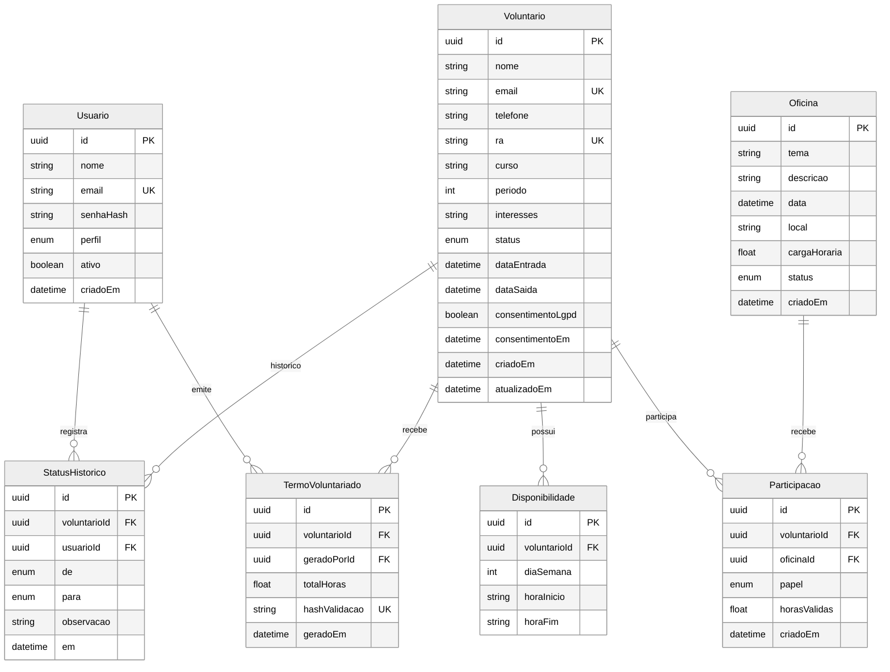

# Diagrama ER — SGV-ELLP

## Legenda

- `PK` chave primária, `FK` chave estrangeira, `UK` valor único.
- **Participacao** é a tabela de junção da relação M:N entre Voluntario e Oficina.
- **StatusHistorico** só recebe inserções (histórico inalterável).
- Status do voluntário: PENDENTE, APROVADO, ATIVO, DESLIGADO.
